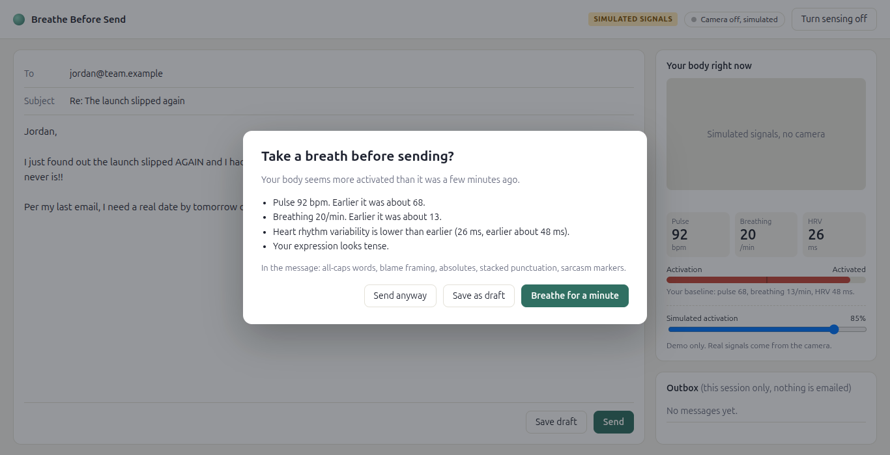
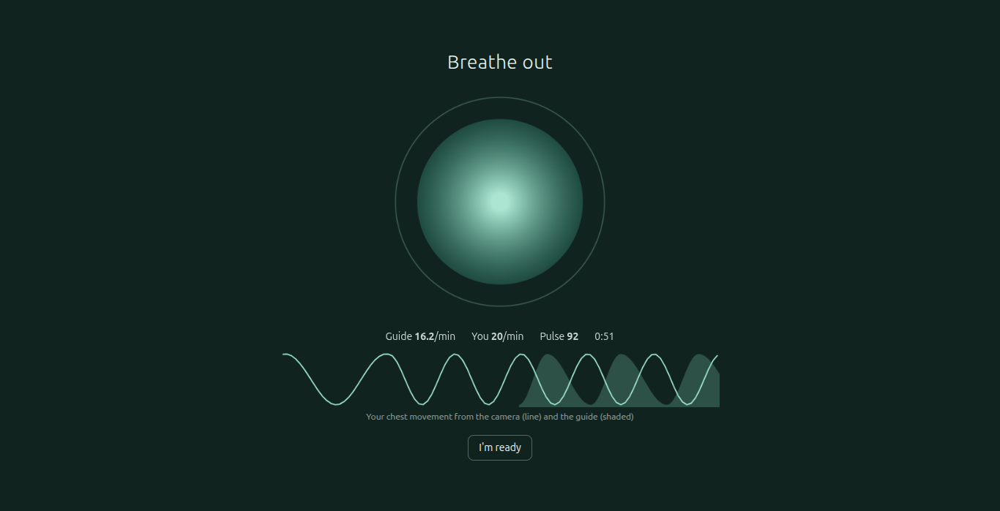
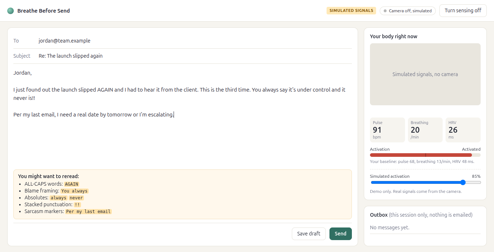

# Breathe Before Send

A desktop message composer that notices when your body is activated and offers you a minute to breathe before you press **Send**.

Messages sent in the heat of the moment are a common way to hurt a relationship or a career. Breathe Before Send uses the [Presage SmartSpectra SDK](https://smartspectra.presagetech.com/docs) to read your pulse, breathing rate and heart rate variability (HRV), and optionally your facial expression, from your webcam while you write. When you press Send while those signals are well above your own calm baseline, it pauses and shows you why. Then it offers a short breathing exercise that starts at your current breathing rate and slows down. You can always send anyway.

It is a self-awareness nudge. It is not a medical, health or stress measurement.

| Pause on Send | Breathe for a minute | Reread |
| --- | --- | --- |
|  |  |  |

*Screenshots from demo mode (simulated signals).*

## How it works

1. **Consent first.** On launch, a consent screen explains what the camera is used for. You choose between turning the camera on, using simulated signals, or writing with no sensing at all. Facial expression and SDK telemetry are separate opt-ins, both off by default.
2. **Baseline.** For the first 45 seconds it learns your typical pulse, breathing rate and HRV for this session. It compares you only to yourself.
3. **Activation score (0–100).** Each change from your baseline adds to the score: pulse (up to 40 points), breathing rate (up to 20), a drop in HRV (up to 20), and, if you opted in, angry, contempt or disgust expressions (up to 20). Readings below the SDK's own "stable" confidence levels are ignored.
4. **Pause on Send.** If the score is at or above 50 when you press Send, a pause screen lists the actual reasons (for example "Pulse 92 bpm. Earlier it was about 68."). A local, rule-based text check can add up to 15 points for ALL-CAPS words, stacked "!!", blame framing and similar phrasing. **Text alone can never trigger a pause.**
5. **Breathe for a minute.** An animated guide starts just below your live breathing rate and eases down to 6 breaths/min over 45 seconds. Your chest movement, as read by the camera, is drawn as a line over the guide, so you can see yourself falling into rhythm.
6. **Before and after.** Pulse, breathing and activation are shown before and after. You return to your draft, where the phrases you might want to reread are listed. Send, edit, or save as a draft.

### SmartSpectra signals used

| Signal | SDK metric / field | Used for |
| --- | --- | --- |
| Pulse rate | `PULSE_RATE` → `cardio.pulseRate` | Activation score, before/after |
| Breathing rate | `BREATHING_RATE` → `breathing.rate` | Activation score, pacer start speed |
| HRV (RMSSD) | `HRV` → `cardio.hrv[].rmssd` | Activation score |
| Chest breathing trace | `CHEST_BREATHING` → `breathing.upperTrace` | Live line in the breathing exercise |
| Facial expression (opt-in) | `EXPRESSIONS` → `face.expression[].scores` | Activation score |
| Validation status | `validationStatus` event | Guidance like "Center your face", and ignoring readings when two faces are in view |

### Architecture

```
┌───────────── main process ─────────────┐        ┌──────── window (sandboxed) ────────┐
│ main.js     reads the API key          │        │ index.html + src/renderer.js       │
│ sensing.js  SmartSpectraSDK            │  IPC   │ src/activation.js  baseline, score │
│             native camera, 30 fps ─────┼──────► │ src/pacer.js       breathing guide │
│             metrics, hints, preview    │        │ src/textcues.js    local text check│
│             retries on slow network    │        │ src/signals.js     SDK or simulator│
└────────────────────────────────────────┘        └────────────────────────────────────┘
```

The SDK captures the camera natively in the main process. That keeps the webcam at 30 fps; capturing through the browser layer let the frame rate drop below the SDK's 25 fps minimum in dim rooms. The window gets only metrics, validation hints and a small preview image through a narrow bridge ([preload.js](preload.js)). It has no Node access, no camera permission and never sees the API key.

## Setup

Requires Node.js 20 or newer (22+ recommended), and one of: Linux x64/arm64 with glibc 2.35+ (Ubuntu 22.04+), macOS on Apple Silicon, or Windows x64.

```bash
git clone https://github.com/AbdulAmmic/breathe-before-send.git
cd breathe-before-send
npm install
cp .env.example .env    # then paste your key into .env
npm start
```

Get a free API key at <https://physiology.presagetech.com/auth/register>. The app reads `SMARTSPECTRA_API_KEY` from the environment or from `.env` at startup. `.env` is git-ignored.

### For good readings

- Light your face from the front (a lamp or a window in front of you, not behind you).
- Keep your head and shoulders in view and sit fairly still.
- Pulse needs about 12 seconds, breathing about 30 seconds and HRV about 60 seconds before the first stable reading.

### No camera or no key? Use demo mode

```bash
npm run demo
```

Demo mode uses **simulated signals** and is clearly labelled in the app. A slider sets the simulated activation, and during the breathing exercise it falls on its own so the full flow can be seen. You can also choose "Try with simulated signals" on the consent screen.

### Check the SDK on your computer

```bash
npm run check-sdk
```

Opens the camera for 60 seconds without the app and prints camera guidance, SDK errors and live readings. Useful if the app shows no readings.

### Tests

```bash
npm test
```

Unit tests cover the baseline and activation model, the text cues, the breathing pacer and the parsing of SDK metrics packets.

## Troubleshooting

| What you see | What to do |
| --- | --- |
| "It is a bit dark" or "The camera is running slowly" | Add light in front of you. Dark rooms make webcams drop below 25 fps. |
| "The connection to Presage is slow. Retrying…" | The SDK checks your key and usage with Presage's servers and downloads its models on first use. The app retries 3 times with a growing delay. A slow connection can take a few tries. |
| "Sensing stopped (SmartSpectra error 5…)" | Network error after all retries. Check your connection and turn sensing on again. |
| Readings never appear with expression on | The expression model is a larger download. Try again with the expression option off. |

## Consent and data handling

- **Consent.** The camera stays off until you press "Turn on camera" on the consent screen. You can also use the app with no sensing, or with simulated signals. A red "Camera on" indicator is always visible, and "Turn sensing off" in the top bar stops the camera at once. If sensing fails, the camera is released and the indicator says so.
- **Only the person at the keyboard.** The app reads one face. If SmartSpectra reports more than one face, readings are ignored until only one remains. The app is not meant to monitor anyone else and must not be used that way.
- **Processing.** SmartSpectra computes vitals on your computer. The app never saves or uploads video. The small preview image stays inside the app. Per [Presage's telemetry documentation](https://smartspectra.presagetech.com/docs/telemetry-and-privacy), the SDK does not send video frames or measured values.
- **Facial expression is opt-in.** It is off unless you tick the box on the consent screen.
- **Storage and retention.** Nothing is written to disk. Readings, your baseline and the outbox exist only in memory and are gone when you close the app. Deleting your data means closing the app.
- **Sharing.** Your message text is never sent anywhere. "Send" puts the message in a local, in-memory outbox; this demo does not send email. The text check is a few local regular expressions, not an AI service.
- **Network use by the SDK.** The SDK contacts Presage to validate the API key, check usage and download its models.
- **SDK telemetry.** **Off by default.** If you tick "Share anonymous SDK telemetry" on the consent screen, the SDK sends one aggregate summary per session: SDK version, platform, frame-rate and performance counts, and validation-state counts. Per Presage, it does not include video, readings, file paths or user identifiers.
- **AI services.** None. The SDK's optional LLM "insights" feature is not used.
- **Electron hardening.** The window runs with `contextIsolation` and `sandbox` on, Node integration off, a strict Content Security Policy, every permission request denied, and no navigation or new windows. The API key stays in the main process.

## Responsible-use notes

- The activation score is relative to your own baseline from the same session. It is not a measure of stress, anxiety or any health condition, and the app makes no such claims.
- Lighting, movement, talking and caffeine all change the readings. The pause is a suggestion; "Send anyway" is always one click away.

## Project layout

```
main.js               Electron main process: window, permissions, API key
sensing.js            SmartSpectra in the main process: camera, metrics, preview, retries
preload.js            Narrow bridge exposed to the window
index.html            UI: composer, consent, pause, breathing and after screens
src/renderer.js       UI logic
src/signals.js        SDK bridge and the simulator, normalized to one sample shape
src/activation.js     Personal baseline and activation score
src/pacer.js          Breathing guide
src/textcues.js       Local rule-based phrasing check
scripts/check-sdk.mjs Standalone SDK and camera check
test/core.test.js     Unit tests
```

## License

MIT for this app's code. The SmartSpectra SDK is licensed separately by Presage Technologies.
